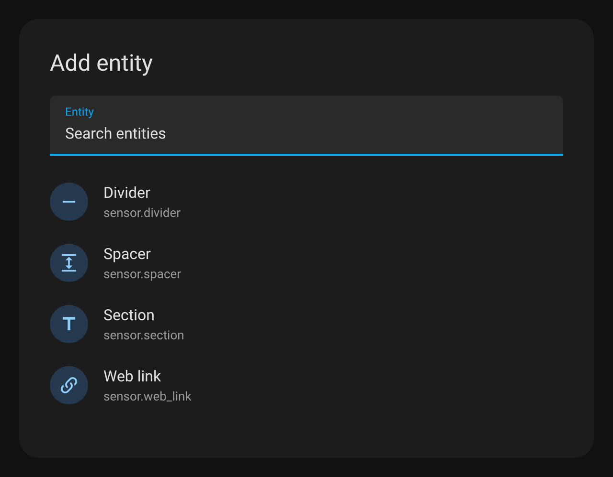
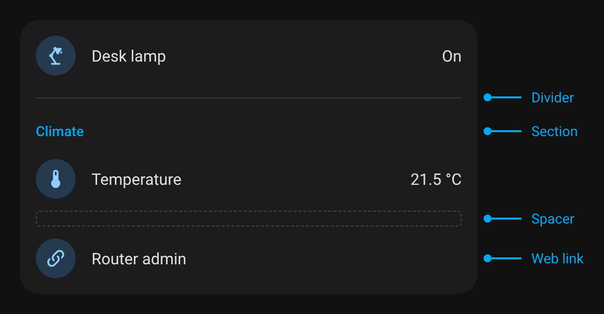

<p align="center">
  <picture>
    <source media="(prefers-color-scheme: dark)" srcset="custom_components/entity_extras/brand/dark_logo@2x.png">
    
  </picture>
</p>

Entity Extras adds the extra row types of the Entities card as real entities. Pick
**Divider** from the entity list in the dashboard editor and you get the same result
as writing this in YAML:

```yaml
- type: divider
```

## What you get



| Entity | Same as | Set up on the row |
| --- | --- | --- |
| `sensor.divider` | `type: divider` | Nothing to set up |
| `sensor.spacer` | An empty gap between rows | Nothing to set up |
| `sensor.section` | `type: section` | Heading text |
| `sensor.web_link` | `type: weblink` | Text, URL and icon |

Search the entity picker for Divider, Spacer, Section or Web link to find them. You
can add the same entity as many times as you like. If you already had an entity with
one of these IDs, Home Assistant adds `_2` to the new one.

Here is how they look in an Entities card:



## Install

**From the Marketplace**

1. Open **Settings > Marketplace** and search for **Entity Extras**.
2. Click **Install**, then install again in the dialog, and restart Home Assistant if
   prompted.

If it does not appear in the search yet, choose **Add from link** in the Marketplace,
enter this repository's address and click **Add**. Choose **Integration** if asked
for a type.

**Manual**

Copy `custom_components/entity_extras` into your `custom_components` folder and
restart Home Assistant.

**Then**

1. Go to **Settings > Devices & services**, choose **Add integration** and add
   **Entity Extras**.
2. Refresh your browser once so the frontend module loads.

## Use

1. Edit an **Entities** card.
2. Add an entity and choose Divider, Spacer, Section or Web link.
3. For a section or web link, click the pencil icon on the row. A section has a
   **Heading** box. A web link has a **Text** box (what the link says), a **URL**
   box and an **Icon**.

Until a URL is set, a web link row shows but does not go anywhere.

If you prefer YAML, the same web link looks like this:

```yaml
- entity: sensor.web_link
  name: My link
  tap_action:
    action: url
    url_path: https://example.com
```

## Notes

- Works in the **Entities** card only. Other cards do not use row types.
- The rows are swapped in when the card renders, so the frontend module must be
  loaded. Refresh the browser after installing or updating.
- These are normal entities, so you can rename them, give them an area or disable
  them. The row type follows the entity, not its name or ID.
- Updating from 1.0.0: the old `ee.*` entities are gone. Pick the rows again in
  your cards.
- The address is saved as a URL tap action on the row. A plain `url:` key is not
  accepted by the visual card editor, so use the form above if you write YAML.
- The text boxes in the row editor are added by the frontend module. If a future Home
  Assistant update changes that editor they may disappear; the YAML form above always
  works.

## Licence

See [LICENSE](LICENSE).
